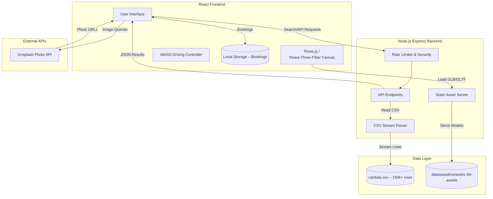
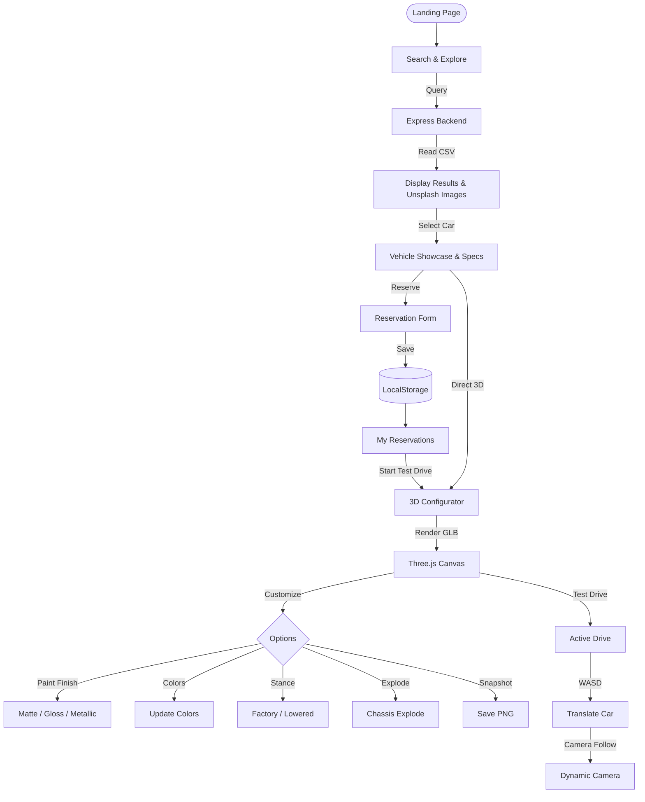

# Axis DriveWorks

**Interactive 3D Car Configurator & Vehicle Search Platform**

---

## Project Overview

Axis DriveWorks is a full‑stack 3D car configurator and vehicle search platform. Users can search a massive vehicle dataset, view detailed specifications, reserve test drives, and explore interactive 3D models with real‑time customization.

---

## New Features

- **Test‑Drive Scheduler** – Reserve a test drive; bookings are stored in local storage and listed on a dedicated *My Reservations* page.
- **WASD Driving Controller** – Engage *Test Drive* mode to drive the vehicle on an infinite neon grid.
- **Exploded View & Stance Options** – Separate chassis components, toggle factory or lowered (track) stance.
- **Dynamic Paint & Wheel Colors** – Choose from a curated palette with live updates.
- **Responsive Mobile Layout** – Optimized UI for tablets & phones, collapsible configuration sidebar.
- **Backend Rate Limiting & Security Headers** – Limits to 60 requests/min per IP and hardened HTTP headers.
- **Zoom‑free UI** – All zoom‑in/out controls removed for a cleaner experience.

---

## System Architecture



---

## How the Website Works



---

## Folder Structure

```bash
axis-driveworks/
├── axisdriveworks/              # Frontend React Application
│   ├── public/                  # Static assets (logo, fallback CSV)
│   │   ├── Logo.png
│   │   └── cardata.csv
│   ├── src/
│   │   ├── Api/                 # API service logic
│   │   │   └── FetchApi.js
│   │   ├── images/              # UI icons & images
│   │   ├── sections/            # Page components
│   │   │   ├── BookingsPage.css / BookingsPage.jsx   # Reservations dashboard (new)
│   │   │   ├── BrandCard.css / BrandCard.jsx
│   │   │   ├── BrandPage.css / BrandPage.jsx
│   │   │   ├── Footer.css / Footer.jsx
│   │   │   ├── Hero.css / Hero.jsx
│   │   │   ├── Search.css / Search.jsx
│   │   │   ├── Showcase.css / Showcase.jsx
│   │   │   └── VehicleCard.css / VehicleCard.jsx
│   │   ├── viewer/              # 3D viewer modules
│   │   │   ├── modelConfig.js
│   │   │   ├── ModelRegistry.jsx
│   │   │   ├── ModelsLibrary.css / ModelsLibrary.jsx
│   │   │   ├── Vehicle3DViewer.jsx
│   │   │   └── ViewerPage.css / ViewerPage.jsx
│   │   ├── App.css / App.jsx    # Router & layout
│   │   ├── index.css            # Global CSS tokens & theme
│   │   └── main.jsx             # React entry point
│   ├── package.json
│   └── vite.config.js
│
├── axisdriveworks-backend/      # Express.js REST API
│   ├── data/
│   │   ├── axisdriveworks-3d-assets/ # GLB/GLTF assets
│   │   └── cardata.csv               # Vehicle database (151k+ rows)
│   ├── server.js
│   └── package.json
│
├── render.yaml                  # Render.com multi‑service config
└── README.md                    # Project documentation (this file)
```

---

## Environment Variables

### Frontend (`.env`)
```env
VITE_API_URL=http://localhost:3000
VITE_UNSPLASH_ACCESS_KEY=your_unsplash_access_key
```
### Backend (`.env`)
```env
PORT=3000
FRONTEND_URL=http://localhost:5173
```
---

## Installation & Setup

1. **Backend**
   ```bash
   cd axisdriveworks-backend
   npm install
   cp .env.example .env   # set PORT & FRONTEND_URL
   node server.js
   ```
2. **Frontend**
   ```bash
   cd axisdriveworks
   npm install
   cp .env.example .env   # set VITE_API_URL & UNSPLASH key
   npm run dev
   ```
---

## Usage

- Open `http://localhost:5173`.
- Search for a brand/model; view results with images.
- Click a car to open the **Showcase** page.
- Use the **Reserve for Test Drive** button to schedule a test drive (saved locally).
- In the **Viewer** page, customize paint, wheels, stance, explode the chassis, or enter **Test Drive** mode with WASD controls.
- Capture a snapshot with the **Capture 2D Snapshot** button.
---

## Future Improvements

- Add persistent user accounts & cloud storage for bookings.
- Replace CSV with a relational database (PostgreSQL/MongoDB).
- Implement PBR materials for realistic rendering.
- Expand backend API for advanced filters (price, engine, drivetrain).
---

## Author

**Adarsh Saripaka**
