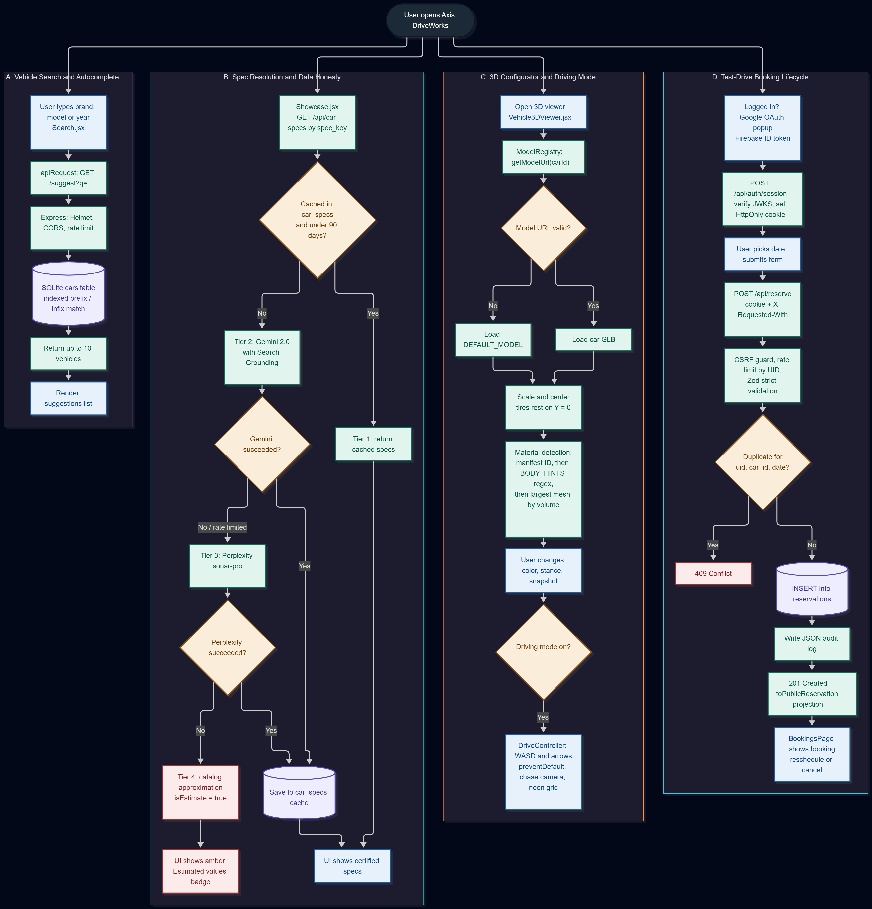
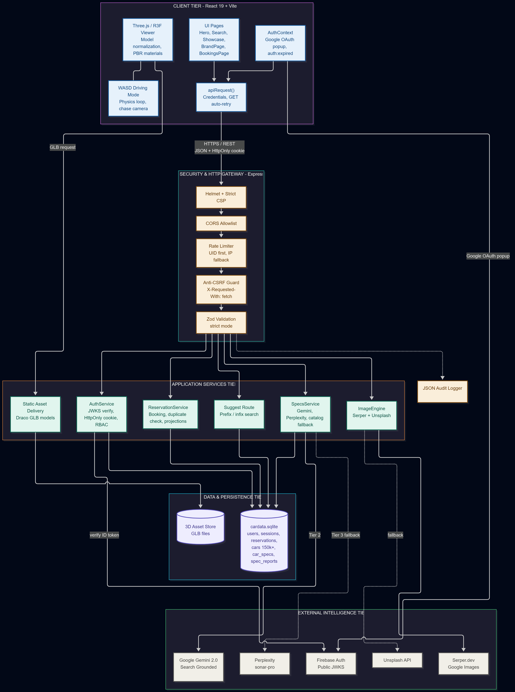

# 🏎️ Axis DriveWorks — Interactive 3D Car Visualizer & Test Drive Portal

Hey everyone! 👋 Welcome to **Axis DriveWorks**, my full-stack web project built as part of my 3rd-year engineering portfolio.

I wanted to build something way beyond standard 2D car catalog sites: a place where you can explore cars in a **real-time 3D showroom**, customize paints and finishes, drive the car around with WASD keys on a cyberpunk neon track, view AI-grounded vehicle specs, and book test drives with proper session security and duplicate-prevention logic.

---

## 📸 Screenshots & Architecture

<p align="center">
  
</p>

<p align="center">
  
</p>

---

## ✨ What I Built & Key Features

### 🎮 1. Real-Time 3D Vehicle Showroom (Three.js & React Three Fiber)
* **Interactive 3D Configurator**: Inspect cars with OrbitControls, switch body finishes (Gloss, Matte, Metallic), and change wheel rim colors.
* **Smart Mesh & Paint Detection**: Many 3D `.glb` models have arbitrary part names. I implemented a regex matcher (`BODY_HINTS`) backed by a volume-bounding algorithm that detects the largest mesh if paint parts aren't labeled.
* **Cyberpunk Test Drive Mode**: Toggle driving mode to pilot the car across an infinite grid with WASD/arrow keys, simulated acceleration, friction, and chase-camera physics (with key-event suppression so the web page doesn't scroll while driving!).
* **Snapshots**: Export high-resolution PNG captures directly from the WebGL viewport.

### 🧠 2. AI Specs Engine with Caching & Fallbacks
* Queries **Google Gemini 2.0 Flash** (with search grounding) and **Perplexity AI** to fetch real horsepower, 0-60 mph times, top speeds, and engine specs.
* **90-Day SQLite Cache**: Caches fetched specs so we don't blow through API rate limits or burn free student tiers.
* **Data Honesty**: If external APIs fail or are exhausted, the app falls back to baseline catalog specs and clearly tags them with an `⚠ Estimated values` badge so users know what's verified vs. estimated.

### 📅 3. Test Drive Scheduling & Booking Lifecycle
* Authenticated booking system allowing users to pick a car and schedule a test drive.
* **Duplicate Prevention**: Rejects past dates and uses atomic SQLite queries to block duplicate bookings for the same user, car, and date (`409 Conflict`).
* Users can view, reschedule, or cancel their bookings directly from their dashboard.

### 🛡️ 4. Real Backend Security (No Fake Client-Only Auth)
* **Google Firebase OAuth + Hardened Cookies**: Firebase popup on the client exchanges Google ID tokens for a server-signed, `HttpOnly`, `SameSite=Lax` session cookie. Raw auth tokens are never left lingering in client storage.
* **Strict Zod Validation**: All incoming requests are sanitized with Zod schemas in strict mode to prevent payload pollution.
* **Rate Limiting & CSRF Protection**: Added sliding-window rate limiting on sensitive routes and enforced custom request headers on mutating HTTP methods.
* **Automated Tests**: Wrote 23 end-to-end integration tests using Node's native test runner (`node --test`) covering auth, CSRF, bookings, and error handling.

---

## 🛠️ Tech Stack

| Layer | Technologies Used |
| :--- | :--- |
| **Frontend** | React 19, Vite, Three.js, React Three Fiber, React Three Drei, Lucide Icons, Vanilla CSS |
| **Backend** | Node.js, Express, SQLite (`better-sqlite3`), Zod, Helmet, Cookie-Parser |
| **Authentication** | Firebase Auth (Google OAuth) + Google Public JWKS Token Verification + HttpOnly Sessions |
| **AI & APIs** | Google Gemini 2.0 API, Perplexity API (`sonar-pro`), Serper Google Images, Unsplash API |
| **Testing** | Node.js Native Test Runner (`test/reservations.test.mjs`) |

---

## 📂 Project Structure

```text
axis-driveworks/
│
├── README.md                            # You are here!
├── axisdriveworks/                      # React Frontend (Vite)
│   ├── src/
│   │   ├── viewer/                      # 3D Graphics & Three.js Configurator Engine
│   │   │   ├── Vehicle3DViewer.jsx      # Canvas, OrbitControls, DriveController physics
│   │   │   ├── ModelRegistry.jsx        # Car model list & asset resolvers
│   │   │   └── modelConfig.js           # Manifests & BODY_HINTS material matcher
│   │   ├── sections/                    # Page components (Hero, Search, Showcase, Bookings)
│   │   ├── context/AuthContext.jsx      # Session state & Firebase login
│   │   └── Api/FetchApi.js              # Central network layer & image cache
│   └── vite.config.js                   # Vite config with manual chunk splitting
│
└── axisdriveworks-backend/              # Express Backend & Database
    ├── server.js                        # Express server entry point, CSP & middleware
    ├── data/
    │   ├── cardata.sqlite               # Master SQLite DB (cars, reservations, specs)
    │   └── axisdriveworks-3d-assets/    # Local 3D GLB assets served via /assets
    ├── lib/
    │   ├── authRoute.js                 # JWKS token validation & cookie sessions
    │   ├── reservationsRoute.js         # Booking CRUD & duplicate checks
    │   ├── validation.js                # Zod schemas
    │   ├── specsFetcher.js              # Gemini 2.0 AI specs engine
    │   └── imageEngine.js               # Car photo search engine
    └── test/reservations.test.mjs       # Automated backend test suite
```

---

## 🗄️ Database Schema

The project uses **SQLite** with WAL mode enabled:

* `users` — Stores verified Google accounts (`id`, `uid`, `email`, `name`, `role`, `created_at`).
* `sessions` — Server-managed session IDs with expiry linked to users.
* `reservations` — Bookings with unique `(uid, car_id, date)` constraints and status tracking.
* `cars` — Master vehicle catalog with brands, models, and years.
* `car_specs` — Cached AI-generated specs (with 90-day expiry and `is_estimate` flags).

---

## 🚀 Running the Project Locally

### 1. Clone the repo
```bash
git clone https://github.com/Adarsh-Saripaka/AutoVision.git
cd AutoVision
```

### 2. Set up Backend
```bash
cd axisdriveworks-backend
npm install

# Copy sample environment config
cp .env.example .env
# Fill in your GEMINI_API_KEY, FIREBASE_PROJECT_ID, etc.

# Start backend server
npm start
# Backend runs on http://localhost:5000
```

### 3. Set up Frontend
```bash
cd ../axisdriveworks
npm install

# Copy sample environment config
cp .env.example .env
# Fill in your VITE_FIREBASE_* credentials

# Start Vite dev server
npm run dev
# Frontend runs on http://localhost:5173
```

### 4. Running the Tests
```bash
cd axisdriveworks-backend
npm test
```
*Runs all 23 integration tests verifying security, auth, and reservation flows.*

---

## 💡 What I Learned
1. **Three.js & WebGL in React**: Handling memory cleanup, managing canvas re-renders, and debugging why arbitrary `.glb` meshes don't share consistent material names.
2. **Session Security Done Right**: Moving away from storing raw JWTs in `localStorage` to `HttpOnly` signed cookies to protect against XSS.
3. **Resilient API Architecture**: Building fallback ladders so that when third-party AI or image APIs hit rate limits, the UI degrades gracefully instead of crashing.

---

## 👨‍💻 Author

**Adarsh Saripaka**  
* 3rd Year B.Tech Computer Science  
* GitHub: [@Adarsh-Saripaka](https://github.com/Adarsh-Saripaka)  
* Repo: [Axis-DriveWorks / AutoVision](https://github.com/Adarsh-Saripaka/AutoVision)
