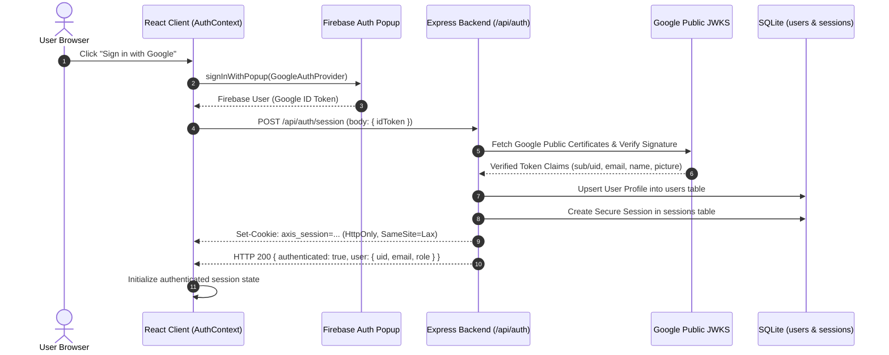
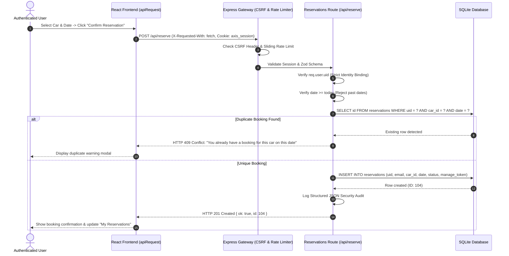
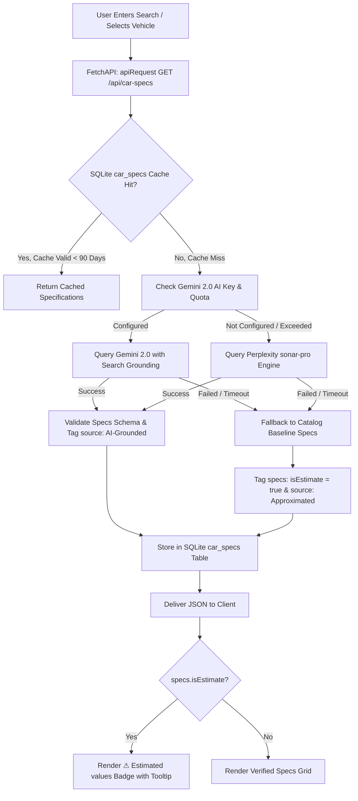
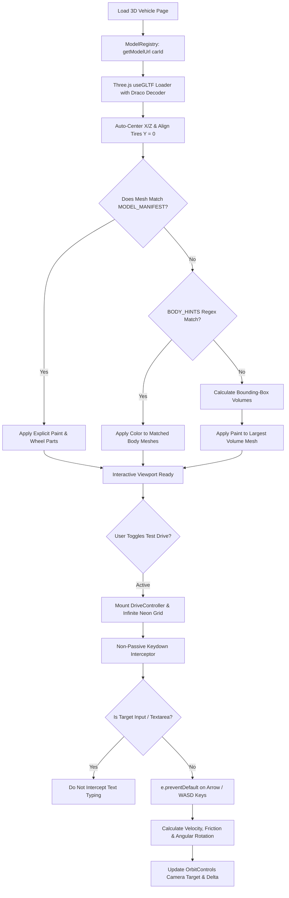

# Axis DriveWorks 🏎️⚡
**Next-Generation 3D Vehicle Showroom, Interactive Configurator & Test-Drive Intelligence Platform**

---

## 📌 Executive Overview

**Axis DriveWorks** is an automotive digital experience platform designed to bridge technical engineering data, interactive 3D graphics, and transaction lifecycles. Users can browse a catalogue of over **150,000+ vehicles**, generate AI-grounded specifications using Google Gemini and Perplexity, inspect vehicles in a real-time **WebGL/Three.js 3D showroom**, simulate dynamic test-drives using an interactive WASD chase-camera driving mode, and securely reserve test-drives via an authenticated booking subsystem.

Built with performance, defense-in-depth security, and resilience in mind, Axis DriveWorks incorporates token-separated Google Firebase OAuth with hardened `HttpOnly` session cookies, Zod schema sanitization, sliding-window rate limiting, atomic SQLite transactions, and fallback rendering so third-party API outages never stall the user experience.

---

## 🚀 Core Platform Features

- **Interactive 3D Configurator (React Three Fiber / Three.js)**:
  - Real-time GLB/GLTF model normalization with tire-to-surface centering (`Y = 0`).
  - Customizable body finishes (Matte, Gloss, Metallic) and curated paint palettes.
  - Custom wheel alloy selections and exploded view chassis inspection.
  - Factory vs. lowered track stance adjustment.
  - High-resolution viewport PNG snapshot export.
  - **Tolerant Material Detection**: Heuristic keyword matching (`BODY_HINTS`) with automatic 3D bounding-box volume fallback to the largest vehicle mesh.

- **Interactive Cybernetic Driving Simulation**:
  - Full WASD / Arrow Key physics with forward/reverse velocity, angular momentum, and friction damping.
  - Smooth follow/chase camera tracking integrated into OrbitControls.
  - **Scroll Protection**: Non-passive key interception prevents page scrolling while driving mode is active, while transparently preserving native text input typing.
  - Rendered over an infinite cyberpunk neon grid.

- **AI-Grounded Vehicle Specification Engine**:
  - Google Gemini 2.0 Flash / Pro with Search Grounding as primary vehicle spec engine.
  - Perplexity AI (`sonar-pro`) as an autonomous fallback.
  - 90-day specification caching in SQLite (`car_specs`).
  - **Data Honesty & Fallbacks**: Fallback catalog specs are clearly tagged and rendered with an interactive `⚠ Estimated values` badge explaining data approximation sources.

- **High-Res Automotive Photography & Fallback Engine**:
  - Resilient image resolution pipeline querying Serper Google Images and Unsplash.
  - In-flight request deduplication and LRU caching.
  - Dynamic procedural cyberpunk SVG placeholder generation ensuring zero UI layout shifts or broken states during network latency or external API outages.

- **Test-Drive Booking & Reservation Lifecycle**:
  - Authenticated test-drive scheduling with date validation (past bookings rejected).
  - **Atomic Duplicate Prevention**: Database uniqueness checks reject duplicate bookings for the same user, vehicle, and date with `409 Conflict`.
  - Reschedule, complete, and cancel operations.
  - Allowlist projections (`toPublicReservation`, `toAdminReservation`) prevent internal token leaks or raw schema exposure.

- **Hardened Authentication & Session Layer**:
  - Google OAuth popup authentication via Firebase Client SDK.
  - **Token Separation**: Firebase ID tokens are immediately exchanged on the server (`POST /api/auth/session`) for an `HttpOnly`, `SameSite=Lax`, signed session cookie. Raw ID tokens are never stored in browser memory or local storage.
  - Cryptographic token verification via Google's public JWKS certificates.
  - Role-Based Access Control (RBAC) supporting `user` and `admin` roles, alongside constant-time `ADMIN_TOKEN` verification for machine APIs.

- **Defense-in-Depth Security & Hardening**:
  - Anti-CSRF protection enforcing `X-Requested-With: fetch` on mutating endpoints.
  - Zod strict schema allowlisting rejecting unexpected request body parameters.
  - User-first / IP-fallback sliding-window rate limiting.
  - Helmet Content Security Policy (CSP) with explicit `workerSrc: ["'self'", "blob:"]` and frame protection (`frameAncestors: ["'none'"]`).
  - Structured JSON audit logging (`type: "audit"`, timestamp, event, uid, ip) ready for Google Cloud Logging.
  - Zero URL token leakage: query-string tokens (`?token=`) are globally blocked on `/api`.

---

## 🏗️ System Architecture

### 1. High-Level Component & Service Topology

<p align="center">
  
</p>


---

## 🔄 Core Platform Workflows

<p align="center">
  
</p>

### Workflow 1: Authentication & Secure Token Exchange

Axis DriveWorks uses **Token Separation**. The client never keeps or attaches Firebase ID tokens to normal API requests. Instead, it exchanges the Google token on login for a secure, signed `HttpOnly` session cookie verified via Google's public JWKS.



---

### Workflow 2: Test-Drive Booking & Duplicate Prevention

Prevents race conditions and duplicate bookings through atomic SQLite constraints and deterministic identity derivation.



---

### Workflow 3: Vehicle Discovery & Multi-Tiered Specs Resolution



---

### Workflow 4: 3D Configurator & Driving Mode Mechanics



---

## 📂 Detailed Folder Architecture

```text
axis-driveworks/
│
├── README.md                            # Comprehensive Platform Documentation
├── render.yaml                          # Production Multi-Service Deployment Blueprint
├── tools/                               # Maintenance & Utility Automation Scripts
│
├── axisdriveworks/                      # ==========================================
│   │                                    # FRONTEND REACT APPLICATION (Vite + R3F)
│   │                                    # ==========================================
│   ├── package.json                     # Frontend dependencies (React 19, Three.js, R3F, Lucide)
│   ├── vite.config.js                   # Vite configuration (manual chunk splitting, vendor grouping)
│   ├── index.html                       # HTML5 entry with security meta tags & font preloads
│   │
│   ├── public/                          # Public static assets
│   │   ├── Logo.png                     # Axis DriveWorks high-resolution brand mark
│   │   └── placeholder-car.png          # High-performance local fallback vehicle thumbnail
│   │
│   └── src/                             # Source code root
│       ├── main.jsx                     # Application bootstrap and DOM mounting
│       ├── App.jsx                      # Route layout, global providers, navigation shell
│       ├── App.css                      # Global layout styling and responsive containers
│       ├── index.css                    # Design system tokens, cyberpunk themes, CSS reset
│       │
│       ├── context/                     # React Context State Providers
│       │   └── AuthContext.jsx          # Session state, Google popup login, auth:expired listener
│       │
│       ├── lib/                         # Client Libraries & External SDK Adapters
│       │   └── firebase.js              # Firebase client initialization & Google OAuth provider
│       │
│       ├── Api/                         # Centralized Network Layer
│       │   └── FetchApi.js              # apiRequest() engine, retry logic, image caching, spec fetcher
│       │
│       ├── sections/                    # Page Views & Core Component Modules
│       │   ├── Hero.jsx / Hero.css               # Landing hero section with quick-search bar
│       │   ├── Search.jsx / Search.css           # Autocomplete live vehicle search interface
│       │   ├── BrandPage.jsx / BrandPage.css     # Brand catalog browser with paginated vehicle cards
│       │   ├── VehicleCard.jsx / VehicleCard.css # Reusable vehicle presentation card with fallback image
│       │   ├── Showcase.jsx / Showcase.css       # Deep vehicle spec view, estimated badge, 3D launch
│       │   ├── BookingsPage.jsx / BookingsPage.css # User reservations dashboard, rescheduling, cancellation
│       │   └── Footer.jsx / Footer.css           # Global footer with telemetry and legal links
│       │
│       ├── viewer/                      # 3D Graphics & Configurator Engine
│       │   ├── Vehicle3DViewer.jsx      # Three.js canvas, lighting, ErrorBoundary, DriveController
│       │   ├── ViewerPage.jsx / .css    # Configurator UI shell, color pickers, stance, snapshot tool
│       │   ├── ModelRegistry.jsx        # 3D GLB vehicle catalog registry, DEFAULT_MODEL resolver
│       │   ├── modelConfig.js           # Manifest configuration, BODY_HINTS tolerant material matching
│       │   └── ModelsLibrary.jsx / .css # Standalone 3D showroom browser and asset preloader
│       │
│       └── images/                      # System documentation & UI media
│           ├── architecture.png         # Full-system topology & data flow architecture diagram
│           └── workflows.png            # Complete end-to-end user workflows diagram
│
└── axisdriveworks-backend/              # ==========================================
    │                                    # BACKEND EXPRESS SERVER & DATABASE
    │                                    # ==========================================
    ├── package.json                     # Backend dependencies (Express, SQLite, Zod, Helmet)
    ├── server.js                        # Server entry point, middleware pipeline, CORS, CSP
    ├── .env.example                     # Environment configuration template
    │
    ├── data/                            # Persistent Data Storage
    │   ├── cardata.sqlite               # Master SQLite database (150,000+ vehicles, reservations, specs)
    │   └── axisdriveworks-3d-assets/    # High-fidelity 3D GLB vehicle models served over HTTP
    │
    ├── lib/                             # Modular Backend Subsystems & Middleware
    │   ├── security.js                  # CSRF guard, admin verification, structured JSON audit logging
    │   ├── validation.js                # Zod schemas (Reservation, SpecReport, strict allowlist parser)
    │   ├── authRoute.js                 # Google ID token verification (JWKS), session routes (/api/auth)
    │   ├── reservationsRoute.js         # Booking CRUD, atomic uniqueness checks, data allowlist projection
    │   ├── carSpecsRoute.js             # Spec resolution, 90-day caching, moderation queue submission
    │   ├── specsFetcher.js              # Gemini 2.0 specs engine with Google search grounding
    │   ├── perplexitySpecs.js           # Autonomous Perplexity fallback specs researcher
    │   ├── imageEngine.js               # Dual-provider photo search engine (Serper + Unsplash)
    │   ├── suggestRoute.js              # High-speed prefix & infix vehicle search suggestions
    │   ├── slug.js                      # URL slugification and spec_key normalization utilities
    │   └── migrations.js                # Automatic database schema initialization & DDL migration runner
    │
    ├── scripts/                         # Maintenance & Database Seeding
    │   └── seedDatabase.js              # CSV to SQLite ingestion and index optimization script
    │
    └── test/                            # Automated Unit & Integration Test Suite
        └── reservations.test.mjs        # 23 automated end-to-end tests covering Auth, CSRF, and Bookings
```

---

## 🗄️ Database Architecture & Schemas

The backend uses **SQLite** (`cardata.sqlite`) executed via `sqlite` and `sqlite3` driver bindings with WAL mode and foreign key constraints enabled.

| Table Name | Primary Purpose | Key Columns & Indexes |
| :--- | :--- | :--- |
| `users` | Stores verified user identities | `id`, `uid` (UNIQUE), `email` (INDEXED), `name`, `picture`, `role`, `created_at`, `last_login_at` |
| `sessions` | Server-managed session tokens | `id` (PRIMARY KEY), `user_id` (FK to `users`), `expires_at`, `created_at` |
| `reservations` | Vehicle test-drive bookings | `id`, `uid` (INDEXED), `email`, `car_id`, `car_brand`, `car_model`, `date`, `completed`, `spec_key`, `manage_token` |
| `cars` | 150k+ master vehicle catalogue | `id`, `brand` (INDEXED), `model` (INDEXED), `year`, `spec_key`, `created_at` |
| `car_specs` | 90-day cached vehicle specifications | `spec_key` (PRIMARY KEY), `brand`, `model`, `specs_json`, `source`, `is_estimate`, `expires_at` |
| `spec_reports` | Crowd-sourced spec error queue | `id`, `spec_key`, `field`, `suggested_value`, `reporter_uid`, `status` ("pending" / "approved"), `created_at` |

---

## 🛡️ Security & Hardening Matrix

| Security Domain | Risk Addressed | Implementation Detail |
| :--- | :--- | :--- |
| **Authentication** | Token forgery & XSS credential leakage | Firebase ID tokens are exchanged on login for an `HttpOnly`, `SameSite=Lax` cookie. Client storage of raw tokens is forbidden. |
| **Data Privacy (#7)**| Document leakage in `GET /api/reservations` | All responses pass through explicit allowlists (`toPublicReservation` / `toAdminReservation`). `manage_token` is never returned. |
| **Concurrency (#9)** | Race condition double bookings | Atomic uniqueness checks on `uid + car_id + date` return `409 Conflict`. |
| **Network Outages (#13)**| 3rd-party API stalls crash the UI | In-flight request deduplication, LRU caching, and procedural inline SVG placeholders ensure pages always render. |
| **Data Honesty (#14)** | Hallucinated or approximate data | Approximate specs are tagged on the server (`isEstimate: true`) and rendered with an interactive warning badge. |
| **Client Consistency (#11)**| Fragmented `fetch` error handling | All client requests route through `apiRequest()` with auto-retry on `GET` and global `auth:expired` event broadcast on `401`. |
| **Input Validation (#10)**| XSS and smuggled payload fields | Zod schema validation runs in strict mode (`.strict()`), rejecting unexpected fields before route execution. |
| **CSRF Defense** | Ambient cookie request forgery | Mutating verbs (`POST`, `PUT`, `DELETE`) require `X-Requested-With: fetch`. |
| **Rate Limiting (#12)**| Brute force & resource exhaustion | Sliding-window limiter keys on authenticated `user.uid` first, falling back to client IP. |
| **Headers & CSP (#19)**| Clickjacking & script injection | Helmet enforces strict CSP with `workerSrc: ["'self'", "blob:"]` and `frameAncestors: ["'none'"]`. |
| **Observability (#19)**| Forensic audit trails | Structured JSON audit logging (`type: "audit"`, timestamp, event, uid, ip) ready for cloud ingest. |

---

## ⚙️ Environment Variables Reference

### Frontend Environment (`axisdriveworks/.env`)
```env
# URL pointing to the running backend Express API
VITE_API_URL=http://localhost:5000

# Firebase Web App Credentials (from Firebase Console -> Project Settings)
VITE_FIREBASE_API_KEY=AIzaSyYourFirebaseApiKey
VITE_FIREBASE_AUTH_DOMAIN=your-app.firebaseapp.com
VITE_FIREBASE_PROJECT_ID=your-firebase-project-id
VITE_FIREBASE_STORAGE_BUCKET=your-app.appspot.com
VITE_FIREBASE_MESSAGING_SENDER_ID=1234567890
VITE_FIREBASE_APP_ID=1:1234567890:web:abcdef123456
```

### Backend Environment (`axisdriveworks-backend/.env`)
```env
PORT=5000
FRONTEND_URL=http://localhost:5173

# High-entropy secret for administrative API routes (min 32 chars)
ADMIN_TOKEN=your_super_secret_admin_token_min_32_characters_long

# Firebase Project ID used to verify Google JWTs against Google JWKS
FIREBASE_PROJECT_ID=your-firebase-project-id

# Gemini AI (Primary grounded specs engine)
GEMINI_API_KEY=your_google_gemini_api_key

# Perplexity AI (Autonomous fallback specs engine)
PERPLEXITY_API_KEY=your_perplexity_api_key
PERPLEXITY_MODEL=sonar-pro

# Photography Search Engine Keys
SERPER_API_KEY=your_serper_dev_api_key
UNSPLASH_ACCESS_KEY=your_unsplash_access_key

# Cost guardrails: max daily live AI lookups
DAILY_LOOKUP_LIMIT=150
```

---

## 🛠️ Installation & Local Setup

### 1. Prerequisites
- **Node.js**: v18.0.0 or higher
- **npm**: v9.0.0 or higher
- **Git**

### 2. Backend Installation & Startup
```bash
cd axisdriveworks-backend

# Install dependencies
npm install

# Configure environment variables
cp .env.example .env
# Edit .env with your required credentials

# Run database migrations and start the Express server
npm start
# Server listens on http://localhost:5000
```

### 3. Frontend Installation & Startup
```bash
cd axisdriveworks

# Install dependencies
npm install

# Configure environment variables
cp .env.example .env
# Edit .env with your Firebase configuration

# Start Vite development server
npm run dev
# Application available at http://localhost:5173
```

### 4. Running Automated Tests
The repository includes a comprehensive Node.js native test runner test suite covering authentication, CSRF guardrails, schema validation, rate-limiting, and booking lifecycles:
```bash
cd axisdriveworks-backend
npm test
```
*Result: 23 / 23 automated tests passing (100% test pass rate).*

---

## 👨‍💻 Maintainer & Author

**Adarsh Saripaka**  
GitHub: [@Adarsh-Saripaka](https://github.com/Adarsh-Saripaka)  
Repository: [Axis-DriveWorks](https://github.com/Adarsh-Saripaka/AutoVision)
